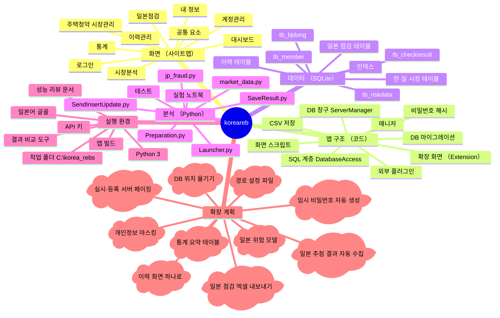
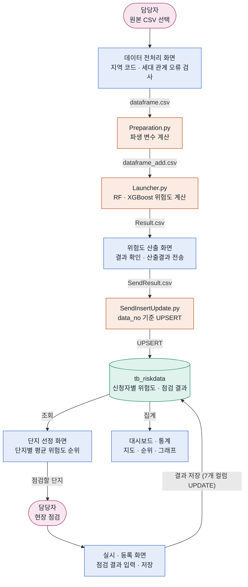
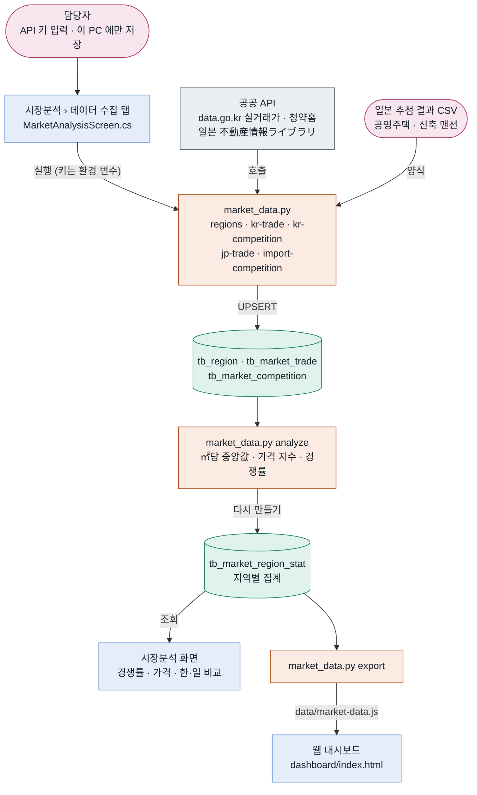
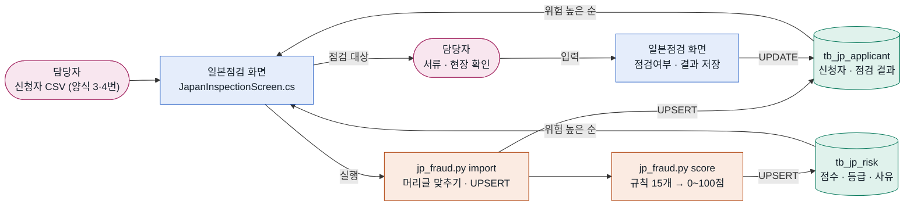
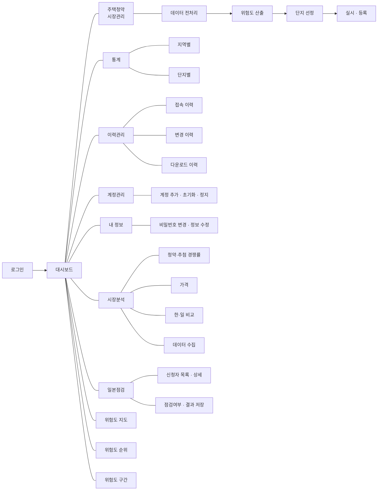
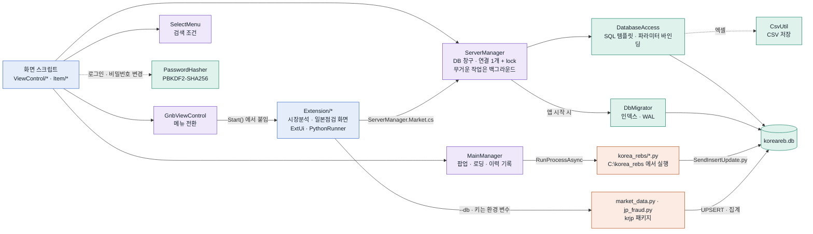
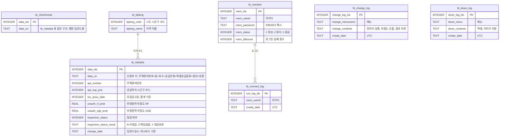
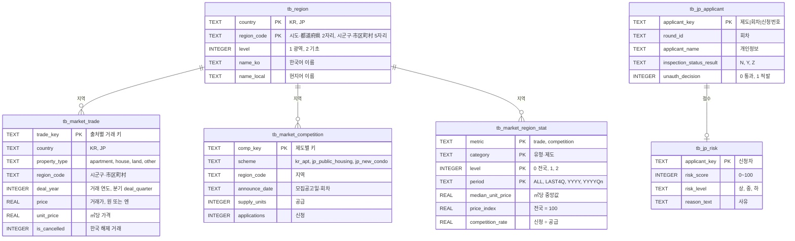

# koreareb · 부정청약 관리 프로그램

청약 신청자 자료를 전처리하고, 부정청약 위험도를 계산해 점검 대상을 고르고, 점검 결과를 기록·집계하는 Windows 데스크톱 프로그램입니다.
Unity 2021.3 앱, SQLite DB, Python 위험도 모델(랜덤 포레스트·XGBoost)로 이루어져 있습니다.

한국·일본 부동산 공공데이터로 **어느 지역에 청약·추첨 신청이 몰리는지, 어느 지역이 싼지** 비교하는 **시장분석** 메뉴와, 일본 기준(공영주택 추첨·신축 맨션 추첨) 부정청약을 점검하는 **일본점검** 메뉴가 있습니다 ([아래](#한일-시장-분석과-일본-점검)).

- **펼치고 접는 전체 지도**: [`docs/system-map.html`](docs/system-map.html) (저장소를 받은 뒤 브라우저로 여세요. GitHub 웹 화면에서는 소스로 보입니다)
- **성능 리뷰와 확인 목록**: [`docs/PERFORMANCE_REVIEW.md`](docs/PERFORMANCE_REVIEW.md)

> ⚠️ `Assets/StreamingAssets/koreareb.db` 와 `korea_rebs/` 의 CSV 에는 개인정보 컬럼이 있습니다. 실제 데이터라면 레포를 비공개로 하고 히스토리에서 지워야 합니다 ([리뷰 문서 0장](docs/PERFORMANCE_REVIEW.md)).

---

## 시스템 맵

프로그램을 여섯 갈래(화면, 코드, 데이터, 분석, 실행 환경, 확장 계획)로 나눈 마인드맵입니다 (노드 101개). 구름 모양은 아직 만들지 않은 계획입니다.
3단계 아래 노드와 노드별 설명·파일은 [`docs/system-map.html`](docs/system-map.html) 에 있습니다.



## 업무 흐름

신청자 자료가 들어와서 점검 결과가 집계되기까지의 흐름입니다. 화살표 이름은 단계 사이에 오가는 파일이나 작업이고, 색은 분홍 담당자 · 파랑 앱 화면 · 주황 Python · 초록 DB 입니다.
로그인과 이력 기록까지 넣은 22단계 흐름도와 단계별 설명은 HTML 지도의 **업무 흐름** 탭에 있습니다.



| 단계 | 화면 | 하는 일 | 남는 것 |
|---|---|---|---|
| 1. 전처리 | 데이터 전처리 | 원본 CSV 의 지역 코드·세대 관계 오류 검사, `Preparation.py` 실행 | `원본_전처리N.csv` |
| 2. 위험도 산출 | 위험도 산출 | `Launcher.py` 가 부정청약·위장전입·불법매매 확률 계산 → 산출결과 전송 | `tb_riskdata` (업로드일시 `change_date`) |
| 3. 점검 대상 | 단지 선정 | 기간·지역·모델·상위 % 조건으로 단지별 평균 위험도 순위 | 엑셀·출력 |
| 4. 점검 결과 | 실시 · 등록 | 신청자별 점검 여부·부정청약 판정 입력 → 결과 저장 | `tb_riskdata` 점검 결과 7개 컬럼 |
| 5. 집계 | 대시보드 · 통계 | 최근 업로드 1년(대시보드), 모집공고일 기준(통계) 집계 | 지도·순위·그래프, 다운로드 이력 |

## 한·일 시장 분석과 일본 점검

### 시장분석: 공공데이터 → 지역 비교



| 자료 | 어디서 | 단위 | 명령 |
|---|---|---|---|
| 한국 아파트 매매 실거래가 | 국토교통부 (공공데이터포털) | 시군구 × 계약월 | `kr-trade --from 202501 --to 202512 --prefs 11,41` |
| 한국 청약 경쟁률 | 한국부동산원 청약홈 (공공데이터포털) | 모집공고일, 주택형 | `kr-competition --from 2025-01-01 --to 2025-12-31` |
| 일본 거래가격·성약가격 | 국토교통성 不動産情報ライブラリ | 都道府県 × 분기 | `jp-trade --years 2024-2025 --prefs 13,14,27` |
| 일본 공영주택 · 신축 맨션 추첨 | 지자체·공사 공개 자료 → CSV 양식 | 회차 | `import-competition --scheme jp_public_housing 파일.csv` |

- **경쟁률** = 신청 ÷ 공급. 한국은 1순위 접수 ÷ 일반공급 세대수, 일본은 응모·등록 수 ÷ 모집·판매 호수. 순위는 공급 20호 이상 지역만 매깁니다.
- **가격** = ㎡당 거래가 중앙값(한국은 해제 거래 제외). **가격 지수** = 지역 중앙값 ÷ 같은 나라·유형·기간의 전국 중앙값 × 100 이라 원과 엔을 직접 비교하지 않고 나라 안의 위치를 나란히 봅니다. 순위는 거래 10건 이상 지역만.
- 기간은 받은 전체, 최근 4개 분기(나라마다 가장 최근 자료 기준), 연도, 분기(웹 대시보드 추이). 지역은 전국 · 시도/都道府県 · 시군구/市区町村.
- 받은 기간은 `tb_market_fetch_log` 에 남겨 다시 호출하지 않습니다(최근 2개월은 다시 받음). 150만 건 집계에 약 11초.
- 웹 대시보드는 `korea_rebs/dashboard/index.html` 을 브라우저로 엽니다. `data/market-data.js` 가 없으면 예시 데이터(`data/sample-data.js`, 화면 위에 '예시 데이터입니다' 안내)로 엽니다.

### 일본점검: 신청자 → 위험 점수 → 점검 결과



| 제도 | 규칙 (가중치) |
|---|---|
| 공영주택 추첨 (都営·区営·市営·公社) | 신청 직전 전입 25 · 단신 거주 기간 부족 35 · 소득 기준 초과 45 · 소득 기준 바로 아래 15 · 신청 직전 세대 변경 20 · 세대 인원과 신청 구분 불일치 30 · 자가·공영주택 거주 40 · 같은 사람 중복 신청 40 · 같은 주소·연락처 다른 세대 30 |
| 신축 맨션 추첨 (분양 등록 추첨) | 한 물건 여러 호실 신청 40 · 연락처·주소 공유 30 · 신청·계약 명의 다름 50 · 인도 전 매물 등록 50 · 투자 목적·본인 미거주 15 · 법인 신청 15 |

- 점수는 가중치 합(최대 100), 상 60 이상 · 중 30 이상 · 하. 일본에는 정답(적발) 자료가 없어 규칙으로 시작했고, 기준값과 가중치는 `korea_rebs/config/jp_rules.json` 으로 바꿉니다. **점수는 먼저 볼 신청자를 고르는 참고값이며 판정이 아닙니다.**
- 점검여부(N 미점검 · Y 점검완료 · Z 해당없음)와 결과(통과 / 적발 + 유형)는 한국 실시·등록과 같은 규칙입니다. 적발로 저장된 신청자는 점검여부를 바꿀 수 없고, 결과는 점검완료 신청자에게만 저장합니다. 실시·등록과 다른 점은 하나입니다: 미점검이나 해당없음으로 바꾸면 저장해 둔 결과(통과·적발과 유형)를 지웁니다. 점검완료가 아닌데 결과만 남은 신청자가 생기지 않게 하려는 것입니다.
- 같은 회차·신청번호를 다시 가져오면 신청 내용만 바뀌고 점검 결과는 남습니다. 신청자 개인정보는 화면에만 보이고 로그·변경 이력에는 제도·회차·인원만 남습니다.
- CSV 양식과 열 설명: [`korea_rebs/templates/README.md`](korea_rebs/templates/README.md). 일본어·한국어·영어 머리글, UTF-8·Shift_JIS·EUC-KR, 和暦(令和8年8月1日) 날짜를 읽습니다.

## 화면 구조

로그인 뒤 대시보드가 첫 화면이고, 상단 메뉴 6개와 내 정보로 갈라집니다. 주택청약 시장관리의 화살표는 쓰는 순서입니다.



| 메뉴 | 화면 | 스크립트 |
|---|---|---|
| (첫 화면) | 로그인 · 대시보드 | `ViewLogin.cs` · `ViewDashBoard.cs`, `ViewMap.cs`, `ViewMapGraphPopup.cs` |
| 주택청약 시장관리 | 데이터 전처리 → 위험도 산출 → 단지 선정 → 실시 · 등록 | `ViewPrepare.cs` → `ViewDangerous.cs` → `ViewDanji.cs` → `ViewExecute.cs` |
| 통계 | 지역별 · 단지별 | `ViewStatisticLocal.cs` · `ViewStatisticDanji.cs` |
| 이력관리 | 접속 · 변경 · 다운로드 이력 | `ViewConnectHistory.cs` · `ViewChangeHistory.cs` · `ViewDownloadHistory.cs` |
| 계정관리 | 계정 목록 | `ViewAccountManager.cs` |
| 내 정보 | 비밀번호 변경 · 정보 수정 | `ViewMyInfo.cs` · `ViewMyInfoEdit.cs` |
| 시장분석 | 청약·추첨 경쟁률 · 가격 · 한·일 비교 · 데이터 수집 (+ 웹 대시보드) | `MarketAnalysisScreen.cs` (+ `korea_rebs/dashboard/index.html`) |
| 일본점검 | 신청자 목록 · 상세 · 점검 결과 저장 | `JapanInspectionScreen.cs` |

메뉴 전환은 `GnbViewControl.cs`, 검색 조건(기간·시도 17개·모델·상위 %) 패널은 `SelectMenu.cs` 가 맡습니다.
시장분석·일본점검은 씬 파일을 고치지 않고 앱이 시작할 때 `ExtensionBootstrap` 이 GNB 에 버튼(계정관리 버튼 복제)과 화면을 붙입니다. 다른 메뉴로 바뀌면 `GnbViewControl.MenuChanging` 을 듣고 닫힙니다.

## 코드 구조

화면 → 매니저 → SQL 계층 → SQLite 순서로 부릅니다. DB 는 `ServerManager` 한 곳에서만 엽니다.
색은 파랑 화면(`Assets/Scripts/ViewControl`, `Item`) · 보라 매니저(`Assets/Scripts/Manager`) · 초록 SQL 계층(`Assets/Scripts/Data`)과 DB · 주황 Python 입니다.



## 데이터 구조

신청자 1명이 `tb_riskdata` 1행(175개 컬럼)입니다. 아래는 화면과 집계가 쓰는 주요 컬럼만 적었습니다.



- 위험도는 부정청약(`unauth`)·위장전입(`fake`)·불법매매(`sale`) 3종 × 랜덤 포레스트(`rf`)·XGBoost(`xgb`) 2개 모델 × (확률 + 상위 50·25·10% 표시) = 24개 컬럼입니다. 예: `unauth_rf_prob`, `fake_xgb_per10`.
- 강원(51)·전북(52) 새 시도 코드는 예전 코드(42·45)로 합쳐 집계합니다.
- 이력 시간은 UTC 로 저장하고 화면에는 +9시간으로 보여 줍니다.
- 앱이 시작할 때 `DbMigrator` 가 인덱스를 추가합니다 (`Sql/migrations/001_performance_indexes.sql` 과 같은 내용).

한·일 시장 분석과 일본 점검 테이블은 마이그레이션 2 (`Sql/migrations/002_korea_japan_market.sql`) 가 만듭니다. 파이썬도 같은 SQL(`korea_rebs/krjp/schema.py`)로 없으면 만들고, 테스트(`tests/test_schema_sync.py`)가 두 쪽이 같은지 확인합니다.



## 폴더

| 위치 | 내용 |
|---|---|
| `Assets/Scenes/Main.unity` | 메인 씬 (`Main_02`, `Main_03` 은 변형본) |
| `Assets/Scripts/ViewControl` | 화면 스크립트 (`MarketManagement`, `Statistic`, `Log`, `AccountManagement`) |
| `Assets/Scripts/Item` | 목록 한 줄 프리팹 스크립트 |
| `Assets/Scripts/Manager` | `MainManager`, `ServerManager`, `GnbViewControl`, `SelectMenu` 등 |
| `Assets/Scripts/Data` | `DatabaseAccess`, `DbMigrator`, `PasswordHasher`, `CsvUtil`, 데이터 클래스 |
| `Assets/StreamingAssets/koreareb.db` | SQLite DB |
| `korea_rebs/` | Python 스크립트(`Preparation.py`, `Launcher.py`, `SendInsertUpdate.py`)와 실험 노트북 |
| `Assets/Scripts/Extension` | 시장분석 · 일본점검 화면 (`MarketAnalysisScreen`, `JapanInspectionScreen`, `ExtUi`, `PythonRunner`, `ExtensionBootstrap`) |
| `korea_rebs/market_data.py`, `jp_fraud.py`, `krjp/` | 한·일 공공데이터 수집·집계, 일본 신청자 가져오기·위험 점수 |
| `korea_rebs/dashboard/` | 웹 대시보드 (`index.html`, `data/market-data.js` 는 `export` 가 만든다) |
| `korea_rebs/templates/`, `config/` | 일본 CSV 양식 4종, 일본 규칙 기준값(`jp_rules.json`) |
| `korea_rebs/tests/` | 파이썬 테스트 (`python -m unittest discover -s tests -t .`) |
| `Sql/migrations/` | DB 변경 SQL (앱이 자동 적용: 001 인덱스, 002 한·일 시장·일본 점검 테이블) |
| `Sql/tools/verify_queries.py` | 이전·새 SQL 결과 비교 도구 (행 내용은 출력하지 않음) |
| `docs/` | 시스템 맵(HTML), 성능 리뷰 문서 |

## 실행 환경

- Windows, Unity 2021.3.20f1
- Python 3 + `pandas`, `numpy`, `scikit-learn`, `xgboost`
- 작업 폴더 `C:\korea_rebs` 에 `korea_rebs/` 의 스크립트와 학습 자료 `dataframe_train.csv` 를 둡니다. 앱이 이 폴더에서 `python` 을 실행합니다.
- 처음 실행하면 콘솔에 `[DB] migration 1 applied`, `[DB] migration 2 applied` 가 찍힙니다. 이때 에디터에서는 저장소의 `koreareb.db` 파일이 바뀌니 커밋하지 마세요.
- 시장분석은 `C:\korea_rebs` 에 `market_data.py`, `jp_fraud.py`, `krjp/`, `config/`, `templates/`, `dashboard/` 도 함께 둬야 합니다 (Python 3.8 이상, 표준 라이브러리 + `pandas`).
- API 키: 공공데이터포털에서 '국토교통부_아파트 매매 실거래가 상세 자료', '한국부동산원_청약홈 분양정보 조회 서비스', '한국부동산원_청약홈 청약접수 경쟁률 및 특별공급 신청현황 조회 서비스' 활용 신청, 일본 不動産情報ライブラリ API 이용 신청. 앱의 **시장분석 › 데이터 수집** 에 넣으면 이 PC 사용자 폴더의 `market_settings.json` 에만 저장되고 실행할 때 환경 변수(`KOREAREB_DATA_GO_KR_KEY`, `KOREAREB_REINFOLIB_KEY`)로 넘어갑니다. 저장소·DB·로그에는 남지 않습니다.
- 일본어 글꼴: 기본 Pretendard 에는 가나·한자가 없습니다. 일본 이름·주소를 보려면 일본어 글꼴(예: Noto Sans JP)로 TMP 글꼴을 만들어 `Assets/Resources/Fonts/JapaneseFallback SDF.asset` 으로 저장하세요 (Atlas Population Mode = Dynamic). 없으면 Windows 일본어 글꼴(Yu Gothic·Meiryo)을 써 보고, 그것도 안 되면 지역은 영어 이름으로 보입니다.

## 시스템 맵 넓히기

마인드맵은 한 줄에 노드 하나인 개요(아웃라인)로 그립니다.

```text
koreareb · 부정청약 관리 프로그램 | 설명 | 파일
  - 화면 (사이트맵) | 설명
    - 로그인 | 아이디·비밀번호 확인 | ViewLogin.cs, PasswordHasher.cs
  - [계획] 새 기능 | 아직 없는 것은 [계획] 을 붙인다
```

- 공백 2칸 들여쓰기 = 한 단계 아래 가지. `|` 뒤에 설명, 그 뒤에 쉼표로 나눈 파일 목록.
- `[계획]` 을 붙이면 HTML 지도에서는 점선, README 마인드맵에서는 구름 모양으로 그립니다.

고치는 순서:

1. `docs/system-map.html` 을 브라우저로 열고 옆 패널의 **개요 편집** 에서 줄을 추가합니다. 고치는 즉시 지도에 반영됩니다.
2. **개요 복사** 를 눌러 `docs/system-map.html` 안의 `<script type="text/plain" id="map-outline">` 내용을 바꿉니다. 브라우저에서 고친 내용은 그 브라우저에만 임시로 남습니다.
3. **README용 Mermaid 복사** 를 눌러 위 [시스템 맵](#시스템-맵) 코드 블록을 바꿉니다.
4. 업무 흐름 탭의 단계는 같은 파일 스크립트의 `STEPS`(단계), `LINKS`(화살표), `PHASES`(가로줄), `LANES`(세로줄) 배열을 고칩니다.
