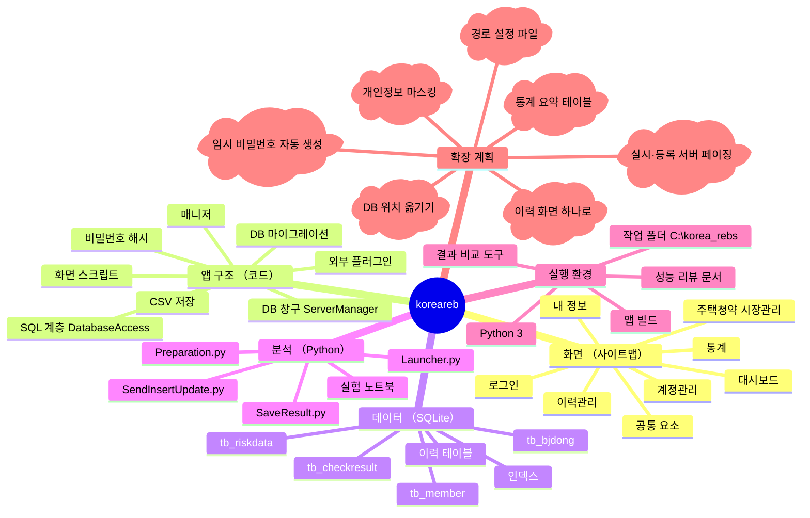
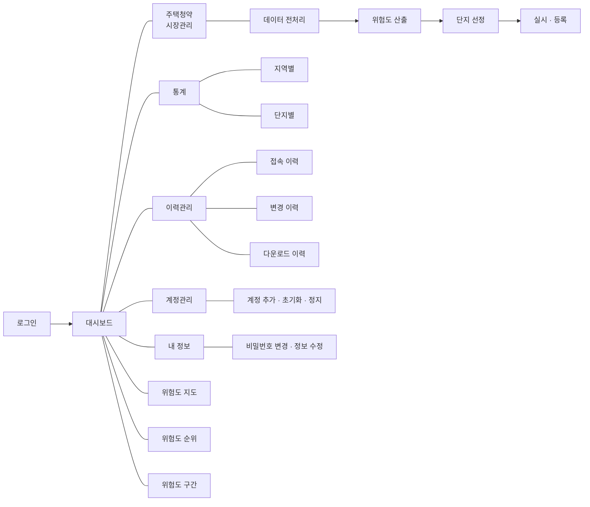
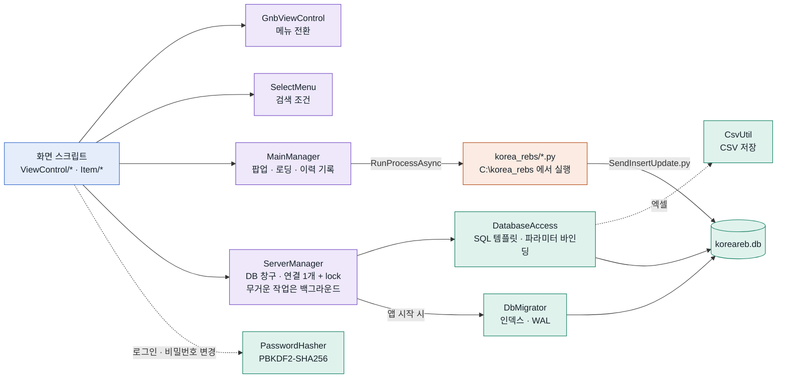

# koreareb · 부정청약 관리 프로그램

청약 신청자 자료를 전처리하고, 부정청약 위험도를 계산해 점검 대상을 고르고, 점검 결과를 기록·집계하는 Windows 데스크톱 프로그램입니다.
Unity 2021.3 앱, SQLite DB, Python 위험도 모델(랜덤 포레스트·XGBoost)로 이루어져 있습니다.

- **펼치고 접는 전체 지도**: [`docs/system-map.html`](docs/system-map.html) (저장소를 받은 뒤 브라우저로 여세요. GitHub 웹 화면에서는 소스로 보입니다)
- **성능 리뷰와 확인 목록**: [`docs/PERFORMANCE_REVIEW.md`](docs/PERFORMANCE_REVIEW.md)

> ⚠️ `Assets/StreamingAssets/koreareb.db` 와 `korea_rebs/` 의 CSV 에는 개인정보 컬럼이 있습니다. 실제 데이터라면 레포를 비공개로 하고 히스토리에서 지워야 합니다 ([리뷰 문서 0장](docs/PERFORMANCE_REVIEW.md)).

---

## 시스템 맵

프로그램을 여섯 갈래(화면, 코드, 데이터, 분석, 실행 환경, 확장 계획)로 나눈 마인드맵입니다. 구름 모양은 아직 만들지 않은 계획입니다.
3단계 아래 노드와 노드별 설명·파일은 [`docs/system-map.html`](docs/system-map.html) 에 있습니다.



## 업무 흐름

신청자 자료가 들어와서 점검 결과가 집계되기까지의 흐름입니다. 화살표 이름은 단계 사이에 오가는 파일이나 작업이고, 색은 분홍 담당자 · 파랑 앱 화면 · 주황 Python · 초록 DB 입니다.
로그인과 이력 기록까지 넣은 22단계 흐름도와 단계별 설명은 HTML 지도의 **업무 흐름** 탭에 있습니다.


| 단계 | 화면 | 하는 일 | 남는 것 |
|---|---|---|---|
| 1. 전처리 | 데이터 전처리 | 원본 CSV 의 지역 코드·세대 관계 오류 검사, `Preparation.py` 실행 | `원본_전처리N.csv` |
| 2. 위험도 산출 | 위험도 산출 | `Launcher.py` 가 부정청약·위장전입·불법매매 확률 계산 → 산출결과 전송 | `tb_riskdata` (업로드일시 `change_date`) |
| 3. 점검 대상 | 단지 선정 | 기간·지역·모델·상위 % 조건으로 단지별 평균 위험도 순위 | 엑셀·출력 |
| 4. 점검 결과 | 실시 · 등록 | 신청자별 점검 여부·부정청약 판정 입력 → 결과 저장 | `tb_riskdata` 점검 결과 7개 컬럼 |
| 5. 집계 | 대시보드 · 통계 | 최근 업로드 1년(대시보드), 모집공고일 기준(통계) 집계 | 지도·순위·그래프, 다운로드 이력 |

## 화면 구조

로그인 뒤 대시보드가 첫 화면이고, 상단 메뉴 4개와 내 정보로 갈라집니다. 주택청약 시장관리의 화살표는 쓰는 순서입니다.



| 메뉴 | 화면 | 스크립트 |
|---|---|---|
| (첫 화면) | 로그인 · 대시보드 | `ViewLogin.cs` · `ViewDashBoard.cs`, `ViewMap.cs`, `ViewMapGraphPopup.cs` |
| 주택청약 시장관리 | 데이터 전처리 → 위험도 산출 → 단지 선정 → 실시 · 등록 | `ViewPrepare.cs` → `ViewDangerous.cs` → `ViewDanji.cs` → `ViewExecute.cs` |
| 통계 | 지역별 · 단지별 | `ViewStatisticLocal.cs` · `ViewStatisticDanji.cs` |
| 이력관리 | 접속 · 변경 · 다운로드 이력 | `ViewConnectHistory.cs` · `ViewChangeHistory.cs` · `ViewDownloadHistory.cs` |
| 계정관리 | 계정 목록 | `ViewAccountManager.cs` |
| 내 정보 | 비밀번호 변경 · 정보 수정 | `ViewMyInfo.cs` · `ViewMyInfoEdit.cs` |

메뉴 전환은 `GnbViewControl.cs`, 검색 조건(기간·시도 17개·모델·상위 %) 패널은 `SelectMenu.cs` 가 맡습니다.

## 코드 구조

화면 → 매니저 → SQL 계층 → SQLite 순서로 부릅니다. DB 는 `ServerManager` 한 곳에서만 엽니다.
색은 파랑 화면(`Assets/Scripts/ViewControl`, `Item`) · 보라 매니저(`Assets/Scripts/Manager`) · 초록 SQL 계층(`Assets/Scripts/Data`)과 DB · 주황 Python 입니다.



## 데이터 구조

신청자 1명이 `tb_riskdata` 1행(175개 컬럼)입니다. 아래는 화면과 집계가 쓰는 주요 컬럼만 적었습니다.


- 위험도는 부정청약(`unauth`)·위장전입(`fake`)·불법매매(`sale`) 3종 × 랜덤 포레스트(`rf`)·XGBoost(`xgb`) 2개 모델 × (확률 + 상위 50·25·10% 표시) = 24개 컬럼입니다. 예: `unauth_rf_prob`, `fake_xgb_per10`.
- 강원(51)·전북(52) 새 시도 코드는 예전 코드(42·45)로 합쳐 집계합니다.
- 이력 시간은 UTC 로 저장하고 화면에는 +9시간으로 보여 줍니다.
- 앱이 시작할 때 `DbMigrator` 가 인덱스를 추가합니다 (`Sql/migrations/001_performance_indexes.sql` 과 같은 내용).

## 폴더

| 위치 | 내용 |
|---|---|
| `Assets/Scenes/Main.unity` | 메인 씬 (`Main_02`, `Main_03` 은 변형본) |
| `Assets/Scripts/ViewControl` | 화면 스크립트 (`MarketManagement`, `Statistic`, `Log`, `AccountManagement`) |
| `Assets/Scripts/Item` | 목록 한 줄 프리팹 스크립트 |
| `Assets/Scripts/Manager` | `MainManager`, `ServerManager`, `GnbViewControl`, `SelectMenu` 등 |
| `Assets/Scripts/Data` | `DatabaseAccess`, `DbMigrator`, `PasswordHasher`, `CsvUtil`, 데이터 클래스 |
| `Assets/StreamingAssets/koreareb.db` | SQLite DB |
| `korea_rebs/` | Python 스크립트(`Preparation.py`, `Launcher.py`, `SendInsertUpdate.py`)와 실험 노트북 |
| `Sql/migrations/` | DB 변경 SQL (앱이 자동 적용) |
| `Sql/tools/verify_queries.py` | 이전·새 SQL 결과 비교 도구 (행 내용은 출력하지 않음) |
| `docs/` | 시스템 맵(HTML), 성능 리뷰 문서 |

## 실행 환경

- Windows, Unity 2021.3.20f1
- Python 3 + `pandas`, `numpy`, `scikit-learn`, `xgboost`
- 작업 폴더 `C:\korea_rebs` 에 `korea_rebs/` 의 스크립트와 학습 자료 `dataframe_train.csv` 를 둡니다. 앱이 이 폴더에서 `python` 을 실행합니다.
- 처음 실행하면 콘솔에 `[DB] migration 1 applied` 가 찍힙니다. 이때 에디터에서는 저장소의 `koreareb.db` 파일이 바뀌니 커밋하지 마세요.

## 시스템 맵 넓히기

마인드맵은 한 줄에 노드 하나인 개요(아웃라인)로 그립니다.

```text
koreareb · 부정청약 관리 프로그램 | 설명 | 파일
  - 화면 (사이트맵) | 설명
    - 로그인 | 아이디·비밀번호 확인 | ViewLogin.cs, PasswordHasher.cs
  - [계획] 새 기능 | 아직 없는 것은 [계획] 을 붙인다
```

- 공백 2칸 들여쓰기 = 한 단계 아래 가지. `|` 뒤에 설명, 그 뒤에 쉼표로 나눈 파일 목록.
- `[계획]` 을 붙이면 HTML 지도에서는 점선, README 마인드맵에서는 구름 모양으로 그립니다.

고치는 순서:

1. `docs/system-map.html` 을 브라우저로 열고 옆 패널의 **개요 편집** 에서 줄을 추가합니다. 고치는 즉시 지도에 반영됩니다.
2. **개요 복사** 를 눌러 `docs/system-map.html` 안의 `<script type="text/plain" id="map-outline">` 내용을 바꿉니다. 브라우저에서 고친 내용은 그 브라우저에만 임시로 남습니다.
3. **README용 Mermaid 복사** 를 눌러 위 [시스템 맵](#시스템-맵) 코드 블록을 바꿉니다.
4. 업무 흐름 탭의 단계는 같은 파일 스크립트의 `STEPS`(단계), `LINKS`(화살표), `PHASES`(가로줄), `LANES`(세로줄) 배열을 고칩니다.
